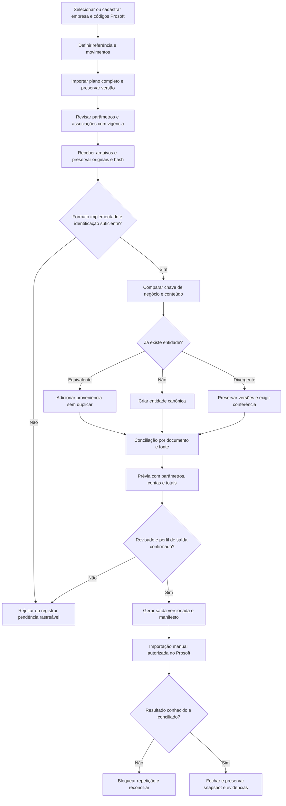

# Mapa funcional do produto e integração incremental

Contexto integral recebido por mensagem em 2026-11-04 após falha de transferência do anexo da Library. Este mapa complementa os fluxos do primeiro incremento e antecede as alterações desta etapa. Repositório próprio, implementação independente; nenhuma cópia do Gerador SPED. Somente dados fictícios nos testes.

Este mapa registra o planejamento e as lacunas anteriores ao incremento de conciliação. Para a implementação posterior de leitura parcial SPED, faturas/parcelas canônicas e observações, consulte [conciliação documental](conciliacao-documental.md) e o README atual.

## Navegação, atores e permissões

Empresa e períodos → Plano e versões → Mapeamentos e revisão → Documentos e conciliação → Prévia de conversão → Revisão/exportação → Histórico e administração.

O painel deve apresentar contexto da empresa, referência dos parâmetros, movimentos, pendências e próximo passo. O protótipo oferece empresa/períodos, plano JSON, mapeamentos, recepção de documentos e histórico. Conciliação, conversão e exportação ainda não são telas implementadas.

| Ator | Operações previstas | Estado atual |
|---|---|---|
| Operador | Cadastrar, importar, conferir, propor associações e gerar prévias | Operador local único, sem controle de papéis |
| Revisor | Revisar associações, resolver divergências e aprovar saída | Separação de função ainda não implementada |
| Administrador autorizado | Gerenciar acesso, retenção e ciclo de vida | Sem administração remota; purga bloqueada |

Cada operação requer contexto da empresa. Identificadores de outra empresa são recusados. Papéis e aprovações de produção dependem de definição do produto; os estados de mapeamento existentes não equivalem a autenticação ou segregação de funções.

## Fluxos A–E

| Fluxo / telas | Entradas e validações | Saídas, erros e decisões |
|---|---|---|
| A — Empresa e períodos / Plano | Cadastro, códigos Prosoft, plano fornecido, referência e movimento válidos, hierarquia e destino analítico | Versões próprias da empresa; DIX usa referência 2026-08 e movimentos 2026-09. Meses configuráveis. Nunca transportar movimentos, saldos ou títulos. Cópia futura de parâmetros exige prévia, confirmação e nova versão. |
| B — Importação / Conciliação | XML NF-e 4.00 modelo 55 parcial; SPED apenas recebido. Validar limites, hash, chave, empresa e competência | Originais preservados, fontes vinculadas, conflito pendente. Não há reconciliação XML × SPED implementada. Sem identificação confiável, exigir conferência; nunca completar chave por suposição. |
| C — Plano / Mapeamentos / Perfil Prosoft | Origem, destino, critério, vigência, versão, autor, justificativa; rejeitar destino sintético, ambíguo ou incerto | Mapeamentos versionados. Seleção automática efetiva e perfil Prosoft pendentes; nenhuma associação aplicada silenciosamente. |
| D — Prévia / Revisão / Exportação | Documentos conciliados, contas aprovadas, perfil confirmado, totais e débitos/créditos consistentes | Resultado imutável com fontes e versões; correções criam nova execução ligada à anterior. Sem contrato Prosoft, bloquear geração. Sem teste real, nunca declarar homologação. |
| E — Histórico / Administração | Empresa, operação, vínculos, responsável, motivo e dependências | Consulta reutilizável; prévia de remoção lógica identifica arquivos/documentos afetados. Confirmação registra auditoria; preserva original e torna documentos pendentes. Purga/restauração e política de retenção pendentes. |

## Matriz de dados e fontes de verdade

| Entidade | Identidade e vínculo | Fonte / preservação | Implementação atual |
|---|---|---|---|
| Empresa | ID próprio e códigos Prosoft | Cadastro local | Persistente |
| Período | Empresa + referência + movimento | Escolha explícita do operador | Persistente |
| Plano e contas | Empresa + versão; conta no plano | Arquivo/modelo efetivamente recebido; sem completar contas | JSON hierárquico; formatos reais, origem e vigência do plano pendentes |
| Mapeamento | Empresa + plano + origem + versão | Decisão com autor, motivo e vigência | Persistente; critério estruturado e resolução de ambiguidades pendentes |
| Arquivo / registro | Empresa + período + tipo + hash; posição do registro | Bytes originais imutáveis | Arquivo persistido; localização por registro ainda parcial |
| Documento fiscal | Empresa + chave NF-e; alternativa versionada apenas quando especificada | Conteúdo de cada fonte, sem descarte silencioso | NF-e parcial canônica com várias fontes; SPED pendente |
| Fatura / parcela | Documento + identificador de título / parcela da fonte | Valores e vencimentos originais, separados de partidas | Extraídos no payload; entidades próprias com IDs canônicos pendentes |
| Processamento / parâmetros | ID e versão; empresa, períodos, plano e associações fixados | Snapshot da execução e vínculo com versão anterior | Pendente |
| Lançamento | Movimento + processamento + linha determinística | Prévia revisada, não simples ocorrência de XML/SPED | Contratos sintéticos; motor persistente pendente |
| Exportação / evidência | Execução + perfil/versionamento + hash | Arquivo gerado, revisão e comprovante Prosoft | Pendente |
| Auditoria | Empresa + operação + responsável + instante | Registro transacional com a alteração | Persistente; ciclo completo depende dos módulos futuros |

## Estados e transições

Arquivo: recebido → validado / pendente / rejeitado. Reenvio registra tentativa sem replicar efeitos. Remoção lógica: estado existente → excluído após prévia e confirmação, sem apagar original ou auditoria; documentos dependentes → pendente. Os estados processado/substituído só serão utilizados quando houver execução e versionamento efetivos.

Mapeamento: rascunho / revisado / aprovado / inativo, sempre em nova versão. Histórico não muda retroativamente. Aplicação automática de vínculo incerto permanece bloqueada.

Processamento futuro: preparado → revisado → importação iniciada → confirmado → conciliado. Falha comprovada preserva tentativa rejeitada; resultado incerto → reconciliação pendente. Não repetir lote iniciado, desconhecido ou já confirmado. Fechamento exige evidências e totais conciliados.

## Dependências e limites de aceite

| Insumo / decisão | Disponibilidade verificada | Consequência |
|---|---|---|
| Plano real e modelos de importação | Não recebidos neste ambiente | JSON fictício testado; não afirmar compatibilidade com formatos reais |
| Layouts e exemplos Prosoft Fiscal/Contábil, versões e relatório | Não recebidos | Exportação e teste real bloqueados; sem acesso direto ao banco Prosoft |
| Perfil C100/C140/C141 modelo 55 | Requisito funcional recebido; especificação ausente | Fatura/parcela vinculadas ao documento; perfil separado ainda pendente, nenhuma saída compatível declarada |
| XML/SPED reais DIX, agosto/setembro 2026 | Não recebidos | Testes fictícios; não presumir transferência de arquivos de outro ambiente |
| Layout SPED de entrada e prioridade em divergência | Não confirmados | SPED preservado e pendente; sem deduplicação XML × SPED declarada |
| Papéis, revisão e aprovação de produção | Não definidos | Protótipo monousuário local; sem serviço em rede |
| Retenção e purga | Não definidas | Somente remoção lógica; não inventar prazo legal |

O requisito C140/C141 para modelo 55 pertence ao perfil de integração Prosoft solicitado. Não o apresentar como EFD oficial. Conferir guia vigente, documentação e exemplos do importador antes de construir saída. Fontes indicadas no prompt ainda não verificadas nesta etapa; a referência 3.1.6 do README original não comprova vigência em 2026.

Aceite incremental: preservar os testes existentes e acrescentar regressões para as falhas corrigidas; isolamento por empresa; identificadores HTTP textuais não geram falso conflito; inconsistências de fatura geram pendência; remoção lógica exige prévia/motivo/confirmação e preserva originais/auditoria. Aceite total ainda depende de conciliação XML × SPED, entidades de títulos/parcelas, snapshots, conversão e perfis de saída testados. CBS/IBS só permanecem nos originais, sem apuração ou classificação.
